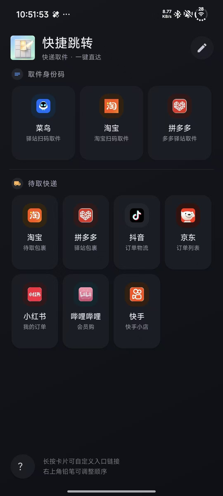
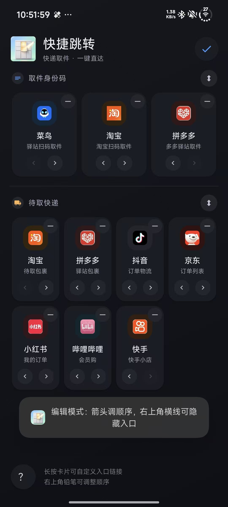

# 快捷跳转 QuickJump

一个纯本地的安卓快递入口小工具：把常用的**取件身份码**和**待取快递**页面收进同一个屏幕，点一下直达，不用在各个 App 里一层层翻菜单。

> 零权限 · 零网络 · 零数据收集 · 无后端 · 无数据库

## 功能

<p align="center">
  
  &nbsp;&nbsp;&nbsp;
  
</p>

<p align="center"><sub>浅色模式 · 深色模式（跟随系统）</sub></p>

### 十个入口，两个分组

| 分组 | 入口 | 直达页面 |
| --- | --- | --- |
| **取件身份码** | 菜鸟 | 菜鸟裹裹驿站身份码 |
| | 淘宝 | 淘宝身份码 |
| | 拼多多 | 拼多多身份码 |
| **待取快递** | 淘宝 | 待收货订单列表 |
| | 拼多多 | 多多驿站包裹列表 |
| | 抖音 | 商城订单 / 物流（兼容抖音极速版） |
| | 京东 | 京东订单列表 |
| | 小红书 | 订单列表 |
| | 哔哩哔哩 | 会员购订单 |
| | 快手 | 快手小店订单（兼容快手极速版） |

### 首页可以自己调

点右上角铅笔进入编辑模式：

* **调整顺序**：卡片下方 `‹ ›` 左右移动；分组右侧 `⇅` 交换两个分组的上/下顺序
* **隐藏入口**：卡片右上角的小横线点一下，该入口变暗并被标记为隐藏；退出编辑后不再显示，再次进入编辑仍可见，点一下即可恢复
* 排序与隐藏状态都保存在本机，重启 App 依然生效；新增入口会自动补在末尾

<p align="center">
  
</p>

<p align="center"><sub>编辑模式：右上角横线隐藏入口，底部箭头调整顺序，分组右侧箭头交换两组</sub></p>

### 其他

* **入口可自定义**：长按任意卡片即可修改该入口的链接，链接失效不用重新打包，保存在本机立即生效
* **多级回退**：每条链接失败会自动降级（换链接 → 拉起目标 App → 网页兜底），尽量保证点得动
* **深色模式**：跟随系统自动切换，卡片、图标底座、状态栏与导航栏配色一并适配
* **全面屏适配**：内容延伸到系统栏之后，背景铺满整屏，底部手势条不再悬空
* **桌面长按菜单**：长按 App 图标，可直接使用 3 个身份码入口
* **关于页**：左下角问号，附「入口体检」可逐条检测深链是否仍然有效

## 下载安装

前往 [Releases](https://github.com/Haven-Lv/QuickJump/releases) 下载最新 APK，传到手机直接安装（需允许「安装未知应用」）。

从旧版本升级可直接覆盖安装，无需卸载。

## 隐私说明

* 不申请任何权限（无网络、无存储、无定位）
* 不读取短信、通知、相册或账号数据
* 自定义的入口链接、排序与隐藏状态仅保存在本机 App 私有目录，不上传
* 代码全部开源，可自行审计

## 实现原理

通过目标 App 公开的 deeplink（`Intent.ACTION_VIEW` + `setPackage` 限定目标包名）跳转到对应内部页面，并对每个入口配置多级回退链：

```
深链逐条尝试  →  直接拉起目标 App  →  网页兜底
```

不使用任何非公开 API，也不请求任何系统权限。目标 App 未安装或深链失效时，会依次降级，不会把用户卡在原地。

## 入口链接失效了怎么办

这些页面入口并非官方开放 API，**目标 App 更新后可能失效**。两种修复方式：

1. **免打包修复**：长按失效的卡片，填入新链接即可（新链接可用「开发者助手」类工具查看，或查询 scheme 汇总库）
2. **更新源码**：修改 `app/src/main/java/com/haven/quickjump/MainActivity.kt` 中的 `ENTRIES` 配置后重新构建

不确定哪一条失效时，可以先点「关于 → 入口体检」，它会逐条列出当前设备上的深链是否可响应。

## 本地构建

需要 JDK 17 与 Android SDK 34（`compileSdk = 34`）：

```bash
./gradlew assembleDebug
```

APK 输出在 `app/build/outputs/apk/debug/app-debug.apk`。

如需构建正式包 `assembleRelease`，在项目根目录放一个 `keystore.properties`（该文件已在 `.gitignore` 中，不会入库）：

```properties
storeFile=/path/to/your.jks
storePassword=******
keyAlias=******
keyPassword=******
```

没有这个文件时 release 会退化为未签名，不影响 `assembleDebug`。

## 致谢

* 上游项目：[chuhe0719/QuickJump](https://github.com/chuhe0719/QuickJump)
* 深链参考：[EidenLiu/pickup-code-launcher](https://github.com/EidenLiu/pickup-code-launcher)（MIT）

## 声明

* 仅供个人学习与自用，**请勿上架应用商店**
* 各页面入口属于第三方 App 的内部链接，版权归对应公司所有
